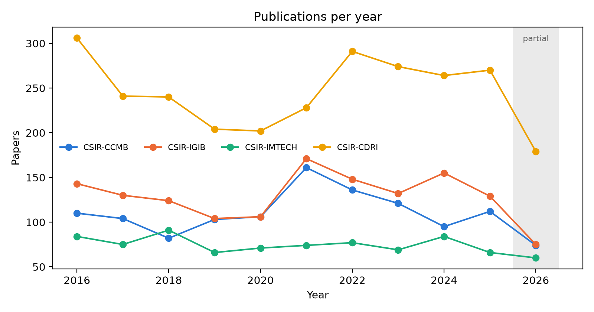
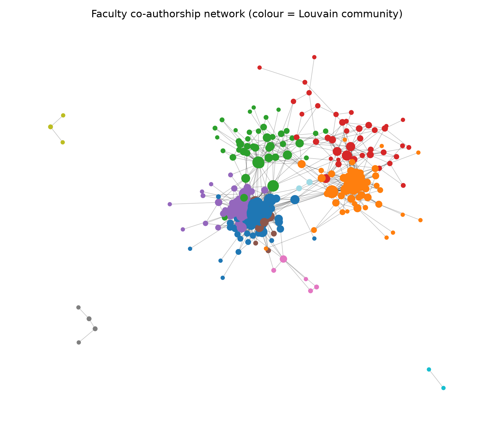

# Mapping Research in Four CSIR Biology Labs (2016–2026)

**DPCN Research Mapping Project · Group 29**
Course: Dynamical Processes in Complex Networks (DPCN), 2026 · Instructor: Chittaranjan Hens

This repository holds our full pipeline for the DPCN research mapping project. We collected ten years of publications from four CSIR life-science laboratories, built citation and co-authorship networks out of them, and traced how these labs connect to the rest of Indian science. Every deliverable (the dataset, the network files, the statistics report and the interactive dashboard) is produced by code in this repo, so anyone can rebuild it from scratch and check our numbers.

| Lab | Full name | City |
|---|---|---|
| **CSIR-CCMB** | Centre for Cellular & Molecular Biology | Hyderabad |
| **CSIR-IGIB** | Institute of Genomics & Integrative Biology | New Delhi |
| **CSIR-IMTECH** | Institute of Microbial Technology | Chandigarh |
| **CSIR-CDRI** | Central Drug Research Institute | Lucknow |

---

## Contents

1. [At a glance](#at-a-glance)
2. [Deliverables](#deliverables)
3. [Getting started](#getting-started)
4. [Running the pipeline](#running-the-pipeline)
5. [How it works](#how-it-works)
6. [Methodological decisions](#methodological-decisions)
7. [Repository layout](#repository-layout)
8. [Quality checks](#quality-checks)
9. [Limitations and open questions](#limitations-and-open-questions)
10. [Working on the project](#working-on-the-project)
11. [Acknowledgements](#acknowledgements)

---

## At a glance

Data snapshot taken from OpenAlex on **2026-10-13**. 2026 is a partial year, so growth figures stop at 2025.

| | CCMB | IGIB | IMTECH | CDRI | **All four** |
|---|---:|---:|---:|---:|---:|
| Faculty on the roster | 56 | 60 | 54 | 124 | **294** |
| Unique papers | 1,204 | 1,417 | 817 | 2,699 | **6,063** |
| Citations received | 36,616 | 36,787 | 22,901 | 55,256 | **144,139** |
| Q1 share (of journal papers with a known quartile) | 71.4% | 62.5% | 76.5% | 63.1% | **66.1%** |
| Institutional h-index | 66 | 74 | 67 | 83 | **123** |
| Indian citation in/out ratio | 0.87 | 1.07 | 1.05 | 0.79 | |

A few things that stood out once the data was in:

- **CDRI is by far the largest producer**, with close to 45% of all papers, but CCMB and IMTECH publish a larger share of their work in Q1 journals.
- **Labs mostly cite themselves.** In the internal citation network, about 95% of lab-to-lab citations stay inside the citing lab; the four labs barely cite one another.
- **IGIB and IMTECH are net receivers of Indian citations** (other Indian institutions cite them more than they cite others), while CCMB and CDRI are net givers.
- **The faculty co-authorship graph splits cleanly into lab-shaped communities.** 274 connected faculty, 1,311 collaboration links, 31 Louvain communities with modularity 0.54. Only 98 links cross between labs.
- **Universities, medical institutes and other CSIR labs are the main collaborators.** Counted by shared papers, the largest partner groups are universities (1,570), medical institutes such as AIIMS, SGPGIMS and KGMU (1,426) and other CSIR labs (1,065), followed by central universities (650), the NIPER campuses (423) and IITs (295).

<p align="center">
  
  
</p>

More figures (quartiles, top journals, h-index histogram, PageRank top 10, Indian citation flow, partner rankings) are in [`outputs/figures/`](outputs/figures/), and every number behind them is in [`outputs/stats/`](outputs/stats/).

---

## Deliverables

Everything the course asks for lives in [`outputs/submission/`](outputs/submission/) and [`outputs/report/`](outputs/report/).

| File | Due | What it contains |
|---|---|---|
| `group29_data.csv` | Week 1–2 | 8,107 rows, one per paper × faculty member × lab. The 14 required columns come first, followed by 18 extra columns (OpenAlex IDs, department, field/subfield, author position, how the lab affiliation was verified, and more) so every statistic can be reproduced from this file alone. |
| `citation_network.csv` | Week 1–2 | 64,240 directed edges: 9,634 between our own papers, 29,304 from our papers to other Indian institutions' work, and 25,302 from other Indian work to ours. |
| `authorship_network.csv` | Week 1–2 | 127,062 co-author pair rows, one per pair per paper, for every paper with up to 50 authors. |
| `indian_connections.csv` | Week 1–2 | 6,182 lab–partner rows with shared papers, citations exchanged in each direction, partner cluster (IIT, NIPER, Medical, …) and topic Jaccard similarity for each lab's top 30 partners. |
| `group29_dashboard.html` | Week 3 | The interactive dashboard. A single file that opens offline in any modern browser; no server or install needed. |
| `group29_report.pptx` / `.pdf` | Week 3 | The 10-slide statistics report. Every number on the slides is read from `outputs/stats/`. |
| `README.txt`, `metadata.json` | | Collection date, row counts and a short summary of the key decisions, for the person grading the submission. |

Supporting files for anyone who wants to dig further: Gephi-ready graphs in [`outputs/networks/`](outputs/networks/) (`.gexf`) and all the statistics tables in [`outputs/stats/`](outputs/stats/).

### The dashboard

Open `outputs/submission/group29_dashboard.html` in a browser. A lab selector at the top (All, CCMB, IGIB, IMTECH, CDRI) drives every panel, and the content is spread across six tabs:

| Tab | What you'll find |
|---|---|
| Overview | Headline numbers and the publication trend |
| Journals | Quartile distribution, top 5 journals, CORE conference ranks |
| Faculty | Searchable, sortable faculty table (department, h-index, papers, citations, top journal) and the h-index histogram |
| Research | Field and subfield breakdown, the 10 most-cited papers |
| Citation network | Interactive directed graph (node size = PageRank), PageRank top 10, in-degree distribution, Indian citation flow by year, top citing institutions |
| Collaboration | Interactive co-authorship graph (faculty-only or the full lab graph, coloured by community or lab), centrality tables, partner rankings with cross-cluster labels, hub authors |

Together these cover all 11 panels listed in the instruction note. The dashboard also supports deep links such as `group29_dashboard.html#tab=citation&lab=CSIR-IGIB&theme=light`, which is handy for sharing a specific view.

---

## Getting started

You will need Git, Python 3.11 or newer (we use Miniconda with 3.12) and a free OpenAlex account.

```bash
git clone https://github.com/Devansh061105/dpcn-group29.git
```
```bash
cd dpcn-group29
```
```bash
conda create -n dpcn python=3.12 -y
```
```bash
conda activate dpcn
```
```bash
pip install -r requirements.txt
```
```bash
pip install -e .
```

**API key.** Sign in at [openalex.org](https://openalex.org), open your account settings and copy the API key. Then copy `.env.example` to `.env` and paste it in:

```
OPENALEX_API_KEY=your-key-here
OPENALEX_EMAIL=you@example.com
```

`.env` is git-ignored, so please never commit it or paste a key into an issue. A free key gives a budget of $1 per day (about 10,000 list calls); without a key it drops to $0.10. Each team member should use their own key.

**Check everything works:**

```bash
python -m dpcn list
```
```bash
python -m dpcn run s00
```
```bash
pytest -q
```

`list` shows every step and whether it's ready, `s00` should report all four labs as verified along with your remaining budget, and the test suite runs fully offline.

---

## Running the pipeline

The pipeline is split into sixteen steps, `s00` to `s15`. You can run one at a time or everything from a given point onwards:

```bash
python -m dpcn run s05
```
```bash
python -m dpcn run all --from s06
```

**On a fresh clone**, the API cache (`data/cache/`) and intermediate tables (`data/interim/`) are not in the repository, so you'll need to rebuild them once:

```bash
python -m dpcn run all --from s02
```

That needs roughly 1,000–1,400 API calls, about $0.20 in total and well inside one day's free budget. Steps S02–S05 take around 30 minutes; the rest is quicker. After that, every OpenAlex response is cached on disk, so re-running any step is free and takes a minute or two.

**After changing a manual input** (the roster, a match decision, a cluster rule), re-run from the step that reads it. For example, after editing `data/manual/faculty_roster.csv`:

```bash
python -m dpcn run all --from s03
```

Some steps take extra options:

| Command | What it does |
|---|---|
| `python -m dpcn run s01 --scrape all --merge` | Scrape the four lab websites again and merge newly confirmed scientists into the roster |
| `python -m dpcn run s01 --add-uncovered` | Add scientists confirmed from `data/review/uncovered_lab_authors.csv` |
| `python -m dpcn run s13 --cdn` | Build a small dashboard that loads its libraries from a CDN instead of inlining them |

The report's PDF is exported automatically if LibreOffice (`soffice`) is on your path; otherwise open the `.pptx` and save it as PDF by hand.

---

## How it works

```
 lab websites        OpenAlex API (cached)                          local processing
┌────────────┐   ┌──────────────┐   ┌──────────────┐   ┌──────────────┐   ┌──────────────┐
│ S01 roster │──▶│ S02 author   │──▶│ S03 match    │──▶│ S04 fetch    │──▶│ S05 filter + │
│            │   │  candidates  │   │ + review     │   │  works       │   │  deduplicate │
└────────────┘   └──────────────┘   └──────────────┘   └──────────────┘   └──────┬───────┘
 Scimago / CORE ─────────────────────▶ S06 quartiles, ranks, research areas ◀─────┤
                                       S07 Indian citation in-flow / out-flow ◀────┤
                         ┌────────────────────────┬───────────────────┬────────────┘
                         ▼                        ▼                   ▼
                 S08 group29_data.csv    S09 citation network   S10 co-authorship network
                         └────────────┬───────────┴───────────────────┘
                                      ▼
                     S11 indian_connections + Jaccard ──▶ S12 statistics + figures
                                                                │
                                   S13 dashboard ◀──────────────┴──────▶ S14 report
                                                                │
                                                     S15 validate + package
```

| Step | What it does | Result |
|---|---|---|
| S00 | Confirms each lab's OpenAlex and ROR IDs and checks the API budget | 4 labs verified |
| S01 | Scrapes the scientist lists from each lab's website, then adds well-known scientists found through authorship evidence | 294 faculty (232 from websites + 62 confirmed from papers) |
| S02 | Pulls every OpenAlex author ever affiliated with each lab | 11,892 candidates |
| S03 | Matches each faculty member to their OpenAlex author ID(s) using ORCID, papers listed on their own web page, then careful name matching, with a human review sheet for the rest | 278 of 294 matched (94.6%) |
| S04 | Downloads every paper by the matched authors, plus each lab's full corpus for comparison; re-fetches papers whose author list was cut off at 100 | |
| S05 | Keeps journal and conference papers only, and only where the faculty member's own byline names the lab; removes duplicates | 6,063 papers, covering 71–81% of each lab's output |
| S06 | Adds Scimago quartiles (matched to publication year), CORE conference ranks, research fields and departments | Quartile known for 93–98% of journal papers |
| S07 | Finds Indian works that our papers cite and Indian works that cite ours | 33,936 cited, 31,482 citing |
| S08 | Writes `group29_data.csv` | 8,107 rows |
| S09 | Builds the citation network: in-degree, PageRank, lab-to-lab matrix, citation flow | 64,240 exported edges |
| S10 | Builds the co-authorship network: degree, betweenness, Louvain communities | 274-node faculty graph, 6,124-node lab graph |
| S11 | Builds `indian_connections.csv`, partner clusters and topic Jaccard | 6,182 lab–partner rows |
| S12 | Computes all statistics tables and figures | `outputs/stats/`, `outputs/figures/` |
| S13 | Generates the dashboard | `group29_dashboard.html` |
| S14 | Generates the 10-slide report | `group29_report.pptx` / `.pdf` |
| S15 | Validates every deliverable (33 checks) and packages the submission zips | All checks pass |

A few principles run through the whole codebase:

- **Cache everything.** Each OpenAlex response is stored as gzipped JSON under `data/cache/openalex/`, keyed by the request URL (never the API key). The client also stops itself before it burns through 90% of the daily budget.
- **Steps are repeatable.** Each one reads only from `data/manual/`, `data/review/`, `data/interim/` or the outputs of earlier steps, and produces the same result every time.
- **Nothing is hard-coded.** Lab IDs, thresholds and paths all come from the files in `config/`.
- **Human decisions are never overwritten.** Accept/reject choices in the review sheets are read back on every run.
- **Numbers in the report come from the data.** The slides are generated from `outputs/stats/`; nothing is typed in by hand.

---

## Methodological decisions

The assignment leaves a lot open to interpretation, and the instruction note and slide deck sometimes disagree. Where they differ we went with the union of both (more columns or panels never hurt) and wrote the choice down. Each decision has an ID (D1–D26) that is referenced in the code comments and in the submission `README.txt`.

### Scope and definitions

| ID | Decision |
|---|---|
| D1 | **Institutions** are CCMB, IGIB, IMTECH and CDRI, following slide 9 of the deck. The instruction note's summary table places CDRI with Groups 27–28, so we have asked the instructor to confirm; dropping a lab is a one-block change in `config/institutions.yaml`. |
| D2 | **Faculty** means scientists and principal investigators listed on the lab's website. Students, postdocs and technical staff still appear as co-authors but don't get their own rows. |
| D3 | Faculty who left during 2016–2026 are included where we could identify them, marked `status = former`. |
| D25 | **Roster growth from authorship evidence.** The websites alone covered only 46–68% of each lab's papers because well-known scientists (current and former) were missing from them. People with at least 8 last- or corresponding-author papers on uncovered lab papers were added after review, which raised coverage to 71–81%. |

### Which papers count

| ID | Decision |
|---|---|
| D4 | A paper counts for a faculty member only if **their own authorship carries the lab affiliation**, either through OpenAlex's institution data or, as a fallback, the raw affiliation text. Papers written before someone joined, or at another institution, don't count. |
| D5 | **One row per paper × faculty member × lab.** A paper with two of our faculty on it gives two rows; paper-level statistics deduplicate on `openalex_id`. |
| D6 | Papers are identified by DOI, falling back to the OpenAlex work URL when there's no DOI. |
| D7 | `type` is `journal` for journal articles, reviews and letters, and `conference` for conference papers. Preprints, book chapters, errata, datasets, peer reviews and retraction notices are excluded. |
| D24 | Each faculty–paper link records how it was made (`lineage` or `raw_string`). A third, weaker rule (`profile_years`) exists but is switched off. |
| D26 | **Name-matching safeguards**, added after auditing early matches by hand: only display names can auto-accept, surnames must agree, given names must line up, web-page ORCIDs must agree with the name, and ambiguous candidates go to manual review. |

### Measures

| ID | Decision |
|---|---|
| D8 | **Quartile** is the Scimago SJR best quartile for the paper's publication year, matched on ISSN then title. Conference papers use their CORE rank. Unknown values are `NA`. |
| D9 | **Q1 fraction** is Q1 papers divided by journal papers with a known quartile. Coverage is always reported alongside it. |
| D10 | **h-index** is computed within the 2016–2026 window from our own dataset, so it can be reproduced from the CSV. OpenAlex's lifetime h-index is shown for context. |
| D20 | **Research area** comes from the OpenAlex primary topic (domain → field → subfield). **Department** comes from the lab website; where none is published (IMTECH), the faculty member's most common subfield is used and flagged. |

### Indian connections

| ID | Decision |
|---|---|
| D11 | An **Indian partner** is any institution in India other than the row's own lab. Umbrella bodies (CSIR HQ, Government of India, ministries, DAE/DBT HQ) are never partners, and AcSIR (CSIR's degree-granting academy, which students list as an affiliation) is excluded by default. |
| D12 | **Partner clusters** (CSIR, IIT, NIPER, Medical, Central University, …) come from rules in `config/cluster_rules.yaml`: institutional lineage first, then name patterns, then institution type. |
| D19 | **Topic Jaccard** between a lab and a partner compares their top 100 OpenAlex topics, for each lab's top 30 partners by shared papers. |
| A8 | `total_citations` in `indian_connections.csv` is citations exchanged in both directions (`cites_in + cites_out`). Because the brief is ambiguous here, `shared_papers_citations` is included too. |

### Networks

| ID | Decision |
|---|---|
| D13 | The **analysis citation graph** contains only our papers and the citations between them; in-degree and PageRank are computed there. The exported edge list adds citations to and from other Indian institutions. Purely foreign edges are counted but not exported. |
| D14 | `year` on a citation edge is the citing paper's year. |
| D15 | Two **co-authorship graphs**: a faculty-only graph (the brief's wording) and a lab-wide graph including students and postdocs. The exported edge list has every pair where at least one author is at one of our labs. |
| D16 | Papers with more than 50 authors (48 of them) are kept in the dataset but left out of pair generation, so huge consortium papers don't swamp the centrality measures. |
| D17 | Communities are detected with **Louvain** (weighted, seed 42), and modularity is reported. |
| D18 | Betweenness is exact on the faculty graph and sampled (k = 1000) on the larger lab graph. |
| D21 | The dashboard is a single self-contained HTML file built with Plotly.js, Tabulator and Cytoscape.js. |
| D22 | Every API response is cached and the collection date is written to `metadata.json`. |

---

## Repository layout

```
dpcn-group29/
├── config/
│   ├── institutions.yaml      the four labs: OpenAlex IDs, ROR IDs, websites
│   ├── settings.yaml          time window, filters, thresholds, network parameters, paths
│   └── cluster_rules.yaml     how partner institutions are grouped into clusters
├── data/
│   ├── manual/                inputs maintained by hand: faculty roster, match overrides,
│   │                          Scimago (sjr/) and CORE (core/) files
│   ├── review/                sheets a person reads and edits: match review, scraped
│   │                          roster drafts, roster gaps, uncovered lab authors
│   ├── cache/                 OpenAlex and web cache (not committed)
│   └── interim/               intermediate parquet tables (not committed)
├── src/dpcn/
│   ├── cli.py                 python -m dpcn list | run <step> | run all --from <step>
│   ├── config.py              loads the YAML config and .env
│   ├── openalex.py            cached, budget-aware OpenAlex client
│   ├── web.py                 polite cached fetcher for lab websites
│   ├── names.py               name cleaning and matching rules
│   ├── corpus.py              lab corpora and the pool of authors on lab papers
│   ├── institutions.py        registry and classifier for every institution seen
│   ├── netdata.py             shared helpers for the network steps
│   ├── dashboard/             HTML template, JavaScript and CSS for the dashboard
│   └── steps/                 s00_verify.py … s15_validate.py
├── tests/                     offline unit tests (no network needed)
├── outputs/
│   ├── submission/            the files we hand in
│   ├── report/                the 10-slide report
│   ├── stats/                 every statistics table (CSV / JSON)
│   ├── networks/              GEXF graphs for Gephi and dashboard JSON
│   └── figures/               PNG figures used in the report
├── requirements.txt
└── pyproject.toml
```

---

## Quality checks

**Automated.** `python -m dpcn run s15` runs 33 checks before anything is packaged, and all of them currently pass. They cover:

- exact column names and order in all four CSVs, with no required column left empty;
- valid values everywhere (years in range, `journal`/`conference` only, quartiles from the allowed set, booleans as `TRUE`/`FALSE`, well-formed DOIs, non-negative citation counts);
- every lab present in every year;
- no duplicate rows, no self-loops, author pairs in canonical order, network endpoints that exist in the main dataset;
- the `cites_indian_inst` and `cited_by_indian_inst` flags agree exactly with the edges in `citation_network.csv`;
- statistics tables contain only our four labs.

**Unit tests.** `pytest -q` covers the logic that decides who and what is included: name matching (including the specific mismatches we caught during auditing), the paper inclusion rules, institution classification, OpenAlex pagination and caching, and network construction. All tests run offline.

**Manual audits.** We read samples of every step's output against the source. This is how we caught, for example, one IGIB profile page listing a different scientist's ORCID, a batch of 169 fungal taxonomy records inflating IMTECH's 2026 count (correctly excluded because they have no journal), and early matching rules that confused people sharing a surname. The dashboard was checked in a browser for every lab and tab in both light and dark themes.

---

## Limitations and open questions

**Things to keep in mind when reading the results:**

- **Coverage is good but not complete.** Our dataset holds 71–81% of each lab's journal and conference output. The rest is mostly papers by students or staff without a roster scientist on them, and papers by a few scientists we couldn't confidently match.
- **16 of 294 faculty are unmatched**, mostly recent joiners or staff with no papers carrying the lab affiliation in the window.
- **Six well-known scientists were skipped** because their OpenAlex profiles merge several different people: Anurag Agrawal, Ajay Kumar Srivastava, Divya Ramesh Singh, Shailendra Kumar Saxena, Brijesh N. Kumar and Vijay Pal Singh. They can be added by hand with title-level evidence.
- **IMTECH publishes no departments**, so its department-level statistics use research subfields instead.
- **2026 is a partial year.** It's shaded in every trend chart, and growth rates stop at 2025.
- **Citation counts are OpenAlex counts** as of 2026-10-13 and will differ somewhat from Scopus or Google Scholar.
- **CORE ranks barely apply.** CORE is a computing venue list; only 1 of our 13 conference papers is ranked. The dashboard panel says so rather than showing an empty chart.

**Questions we have raised with the instructor:**

1. Should CDRI be included? The deck lists it under Group 29, but the note's table puts it under Groups 27–28. We have included it.
2. Is "scientists and PIs listed on the website, plus confirmed scientists found through authorship" an acceptable definition of faculty?
3. Should `total_citations` mean citations exchanged between the two institutions, or total citations of their shared papers? We provide both.
4. Should the h-index be computed within the window or over a whole career? We show both, with the window value as primary.
5. Are extra columns after the 14 required ones acceptable?
6. Is a self-contained HTML file acceptable for the dashboard, or does it need to be hosted?

**Still to do before final submission:**

- A second team member to review the 62 scientists added from authorship evidence (`source = uncovered-author list (S05)` in `data/manual/faculty_roster.csv`).
- Correct the wrong ORCID for `IGIB-014`, which was copied from the IGIB website.
- Manual spot checks: 20 random rows against publisher pages, and the top 10 cited papers against Google Scholar.

---

## Working on the project

- **Branches and reviews.** Work on a branch per change (for example `feat/s09-pagerank`), open a pull request, and have someone else on the team review it before merging into `main`.
- **What to commit.** Code, config, `data/manual/`, `data/review/` and the outputs. Never commit `.env`, `data/cache/` or `data/interim/`.
- **Tests first for inclusion logic.** Anything that decides which people or papers are included needs a unit test with a small hand-built example. Run `pytest -q` before pushing.
- **Audit before trusting.** After any step that selects or links records, read a sample of the output against the source. A good-looking match rate hid several bugs early on.
- **If new journals appear** (for example after a roster change), the Scimago files need refreshing; see [`data/manual/sjr/README.md`](data/manual/sjr/README.md).
- **Course rules.** Groups work independently: don't share data with or merge data from other groups. Any collaboration has to be cleared with the instructor first.

**Troubleshooting a few common issues:**

| Problem | Fix |
|---|---|
| `BudgetExceeded` | The daily OpenAlex budget is nearly used up. Wait for the reset at midnight UTC or use another team member's key; cached progress is kept. |
| HTTP 429 from OpenAlex | The client backs off automatically. If it keeps happening, raise `sleep_s` in `config/settings.yaml`. |
| Encoding errors on Windows | Set `PYTHONIOENCODING=utf-8` in your shell. |
| Excel garbles DOIs or names | Open the CSVs through *Data → From Text/CSV* with UTF-8 encoding. The files themselves are fine. |
| A faculty member's paper count looks far too high | Their OpenAlex profile probably merges several people. Add a row with that `faculty_id`, `author_id` and `decision = reject` to `data/manual/faculty_match_overrides.csv`, then re-run from `s03`. |

---

## Acknowledgements

- [OpenAlex](https://openalex.org) for open bibliographic data and the API this project is built on.
- [SCImago Journal & Country Rank](https://www.scimagojr.com) for journal quartiles, and the [CORE portal](https://portal.core.edu.au) for conference rankings.
- The CCMB, IGIB, IMTECH and CDRI websites, which provided the starting faculty rosters.
- Chittaranjan Hens, for designing the project and the course.
